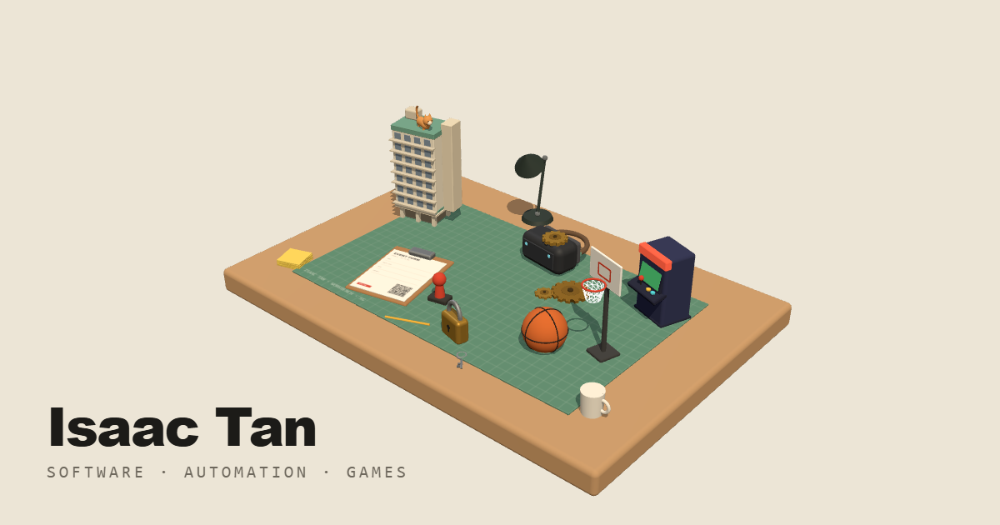
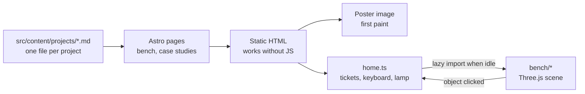

# Isaac Tan · Portfolio

My portfolio site: [isaactzl.github.io/DigitalPortfolio](https://isaactzl.github.io/DigitalPortfolio/)



The home page is a small workbench in 3D. Each object on it is something I built: the clipboard is the event-form tool from my internship, the hoop is Hardwood Hustle, the headset is Cogsworth's Forge, the HDB block is HDB Cats. Click one and the rubber stamp presses down and a work-order ticket slides out with the project. Switch the desk lamp on and the site goes into evening mode.

## How it's built

| Piece    | Choice                                         |
| -------- | ---------------------------------------------- |
| Site     | [Astro](https://astro.build), static output    |
| Language | TypeScript                                     |
| 3D       | Three.js, bundled from npm                     |
| Tests    | Vitest (logic), Playwright + axe (browser)     |
| Quality  | ESLint, Prettier, `astro check`, Lighthouse CI |
| Hosting  | GitHub Pages, deployed by GitHub Actions       |



### The bench is code, not models

There are no model files. Every object is built from Three.js primitives in its own file under [`src/scripts/bench/objects/`](src/scripts/bench/objects/), so the whole scene is about 147 KB of gzipped JavaScript and nothing else to download. The form on the clipboard, the cutting-mat grid and the slot's tag are drawn onto canvases at runtime.

### Decisions and trade-offs

- **The 3D is never the only way in.** The ticket stubs beside the bench are ordinary links to the case studies. With JavaScript off, or on a device without WebGL, the page shows a still render of the bench and the links still work. The browser tests check this.
- **The poster carries first paint.** The bench loads only once the browser is idle, builds one object per task so input isn't blocked, and compiles its shaders asynchronously before the first frame. It stops rendering when it's off screen or the tab is hidden.
- **One source of truth for projects.** Each project is a Markdown file with a typed schema ([`src/content.config.ts`](src/content.config.ts)). The bench labels, tickets and case-study pages all read from it.
- **Strict Content Security Policy.** Scripts, styles and fonts all come from this site. The one inline script, the few lines that set the lamp before first paint, is allowed by its exact SHA-256 hash and nothing else inline can run. The only third party allowed is the YouTube player, which loads from `youtube-nocookie.com` only after you press Play.
- **The lamp is the dark mode.** It follows your system setting on first visit, remembers your choice, and is set by a tiny script before first paint so the page never flashes the wrong colours.
- **Accessible by default.** Keyboard support for the tickets (Enter opens, Escape closes and returns focus), visible focus rings, reduced-motion support, and colour contrast checked in both day and evening modes.

## Numbers

Measured with Lighthouse 13 (simulated mid-range phone):

| Page         | Performance | Accessibility | Best practices | SEO |
| ------------ | ----------- | ------------- | -------------- | --- |
| Home (bench) | 84          | 100           | 100            | 100 |
| Case study   | 99          | 100           | 100            | 100 |
| About        | 100         | 100           | 100            | 100 |

The home page's score is held back by rendering the 3D scene in software under Lighthouse's throttled CPU; largest contentful paint is about 2 s and layout shift is near zero. CI fails the build on the metrics visitors feel (first and largest paint, layout shift) and on accessibility, best practices and SEO for every page. The home page's overall performance score only warns, because on CI's shared, GPU-less runners it swings with the hardware. Budgets are in [`lighthouserc.json`](lighthouserc.json).

## Running it

Needs Node 22.23.4 or newer.

```sh
npm install
npm run dev          # local dev server
npm run build        # production build into dist/
npm run preview      # serve the production build
```

Checks, the same ones CI runs:

```sh
npm run lint
npm run format:check
npm run check        # TypeScript and Astro diagnostics
npm test             # unit tests
npm run test:e2e     # browser tests against the production build
```

## Layout

```
src/
  content/projects/   one Markdown file per case study
  content/other.json  smaller projects
  components/         tickets, stamp, video, the duplicate-booking demo
  pages/              home, case studies, other work, about, 404
  scripts/bench/      the 3D scene: stage, picking, stamp press, one file per object
  scripts/            home page behaviour, the lamp, the demo logic
e2e/                  Playwright tests
public/               CV, poster, share image, favicon
```

## Contact

[LinkedIn](https://www.linkedin.com/in/isaac-tan-zl/) · [GitHub](https://github.com/isaactzl)
