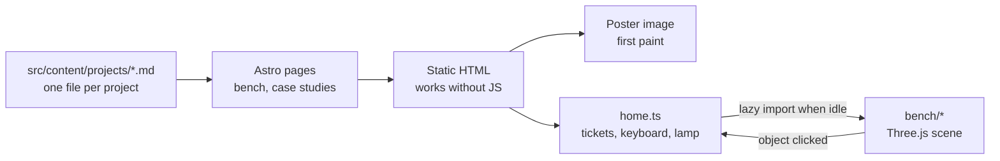

# Isaac Tan · Portfolio

My portfolio site: [isaactzl.github.io/DigitalPortfolio](https://isaactzl.github.io/DigitalPortfolio/)


The home page is a small workbench in 3D. Each object on it is something I built: the clipboard is the event-form tool from my internship, the hoop is Hardwood Hustle, the headset is Cogsworth's Forge, the HDB block is HDB Cats, the padlock is the write-up of how I hardened this site, and the arcade cabinet is Mainframe Run, a retro game I made to revise for my DISE role. Click one, or pick it with the arrow keys, and the rubber stamp presses down and a work-order ticket slides out with the project. Switch the desk lamp on and the site goes into evening mode. The cat on the roof watches your cursor, and the basketball bounces if you click it.

## How it's built

| Piece    | Choice                                                             |
| -------- | ------------------------------------------------------------------ |
| Site     | [Astro](https://astro.build), static output                        |
| Language | TypeScript                                                         |
| 3D       | Three.js, bundled from npm                                         |
| Tests    | Vitest (logic), Playwright + axe (browser)                         |
| Quality  | ESLint, Prettier, `astro check`, Lighthouse CI, CodeQL, Dependabot |
| Hosting  | GitHub Pages, deployed by GitHub Actions                           |



### The bench is code, not models

There are no model files. Every object is built from Three.js primitives in its own file under [`src/scripts/bench/objects/`](src/scripts/bench/objects/), so the whole scene is about 150 KB of gzipped JavaScript and nothing else to download. The form on the clipboard and the cutting-mat grid are drawn onto canvases at runtime. The QR codes are real: the one on the clipboard and the ones on each ticket open the matching case study.

### Decisions and trade-offs

- **The 3D is never the only way in.** The ticket stubs beside the bench are ordinary links to the case studies. With JavaScript off, or on a device without WebGL, the page shows a still render of the bench and the links still work. The browser tests check this.
- **The poster carries first paint.** The bench loads only once the browser is idle, builds one object per task so input isn't blocked, and compiles its shaders asynchronously before the first frame. It stops rendering when it's off screen, when the tab is hidden, or after 15 seconds with nobody touching it, and wakes the moment you do. Phones in data-saver mode or with very little memory keep the still render until you tap "Load the 3D bench". There are day and evening versions of the still render, and only the one matching the lamp is downloaded.
- **One source of truth for projects.** Each project is a Markdown file with a typed schema ([`src/content.config.ts`](src/content.config.ts)). The bench labels, tickets and case-study pages all read from it.
- **Strict Content Security Policy.** Scripts, styles and fonts all come from this site, and there is no `unsafe-inline`. The page's CSS and the few lines that set the lamp before first paint are inlined so first paint never waits on another request; Astro writes each one's SHA-256 hash into the policy at build time, so any other inline code is blocked. The only third party allowed is the YouTube player, which loads from `youtube-nocookie.com` only after you press Play.
- **A locked-down pipeline.** Every GitHub Action is pinned to a commit hash, checkouts don't keep the token, and only the deploy job can publish. Dependabot keeps the pins and packages current, and CodeQL scans every change. How to report a problem is in [`SECURITY.md`](SECURITY.md).
- **The lamp is the dark mode.** It follows your system setting on first visit, remembers your choice, and is set by a tiny script before first paint so the page never flashes the wrong colours.
- **Accessible by default.** The bench itself takes keyboard focus (arrow keys pick, Enter opens), tickets close with Escape and return focus, focus rings are visible, reduced motion is respected, and colour contrast is checked in both day and evening modes.
- **The game is plain TypeScript on a canvas.** Mainframe Run ([`src/game/`](src/game/)) has no engine. Its rules (movement, bots, the clock, answer checking, saved stats) are pure functions with unit tests, and only the drawing and input touch the browser. The questions live in one JSON file that the content schema checks at build time.
- **Sound is opt-in.** A stamp thunk and a light-switch click, synthesised with the Web Audio API so there are no audio files. Off until you switch it on, and remembered.

## Numbers

Measured with Lighthouse 13 (simulated mid-range phone):

| Page         | Performance | Accessibility | Best practices | SEO |
| ------------ | ----------- | ------------- | -------------- | --- |
| Home (bench) | 72–79       | 100           | 100            | 100 |
| Case study   | 98–100      | 100           | 100            | 100 |
| About        | 100         | 100           | 100            | 100 |

The home page's score is held back by rendering the 3D scene in software under Lighthouse's throttled CPU; first paint is about 0.7 s, largest contentful paint about 2 s, and layout shift near zero. CI fails the build on the metrics visitors feel (first and largest paint, layout shift) and on accessibility, best practices and SEO for every page. The home page's overall performance score only warns, because on CI's shared, GPU-less runners it swings with the hardware. Budgets are in [`lighthouserc.json`](lighthouserc.json).

## Running it

Needs Node 22.23.4 or newer.

```sh
npm install
npm run dev          # local dev server
npm run build        # production build into dist/
npm run preview      # serve the production build
```

Checks, the same ones CI runs:

```sh
npm run lint
npm run format:check
npm run check        # TypeScript and Astro diagnostics
npm test             # unit tests
npm run test:e2e     # browser tests against the production build
```

## Layout

```
src/
  content/projects/   one Markdown file per case study
  content/other.json  smaller projects
  components/         tickets, stamp, QR code, video, the duplicate-booking demo and diagram
  pages/              home, case studies, other work, about, how it works, the game, 404
  scripts/bench/      the 3D scene: stage, picking, stamp press, one file per object
  game/               Mainframe Run: rules, sprites, input, the game loop
  content/questions.json  the game's question bank
  scripts/            home page behaviour, the lamp, sound, the demo logic
  data/               site details and the lamp script (shared with the CSP config)
e2e/                  Playwright tests
public/               CV, poster, share images, favicon
```

## Contact

[LinkedIn](https://www.linkedin.com/in/isaac-tan-zl/) · [GitHub](https://github.com/isaactzl)
